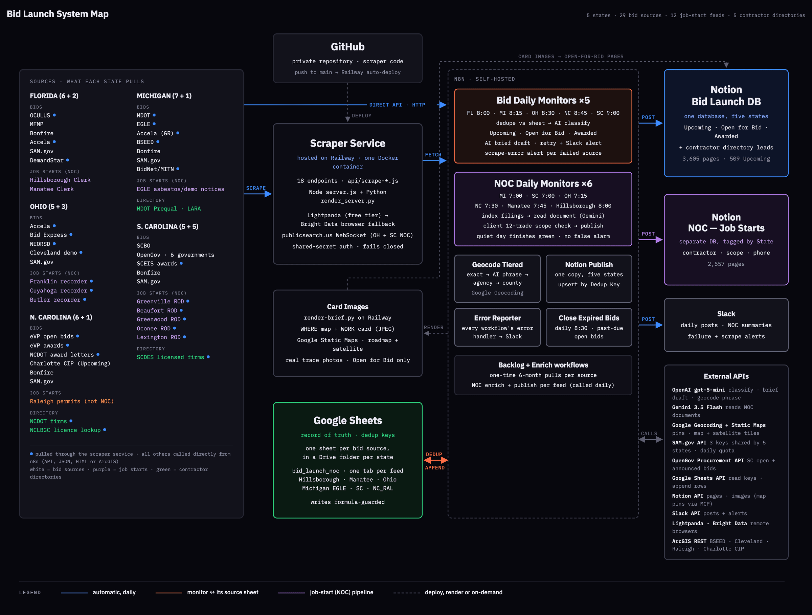

# Bid Launch

Bid Launch finds construction work for a Gulf Coast specialty contractor before competitors do. The client
self-performs asbestos abatement, demolition, concrete and underground utilities. Every morning the system scans
government bid portals, award notices, recorded Notices of Commencement and city capital-project plans in five US
states. It keeps only work in the client's trades and drafts a short brief for each job. It then publishes everything
to a shared Notion board that the client and the agency work from.

> **About this repository.** This is the public overview. The system was built for a client, so the source code, the
> 11-part technical documentation and the 26 n8n workflow exports live in a private repository. Server addresses and
> account names are removed from everything here.

*System map as of 2 October 2026.*

## At a glance (2 October 2026)

| | |
|---|---|
| States | Florida, Michigan, Ohio, North Carolina, South Carolina |
| Bid sources | 29 (Upcoming, Open for Bid, Awarded) |
| Job-start feeds | 12 (11 Notice of Commencement / notification feeds + Raleigh permits, labelled "not NOC") |
| Contractor directories | 5 (NCDOT firms, NCLBGC licences, MDOT prequal, LARA, SCDES) |
| Notion bid database | 3,605 pages (509 Upcoming) |
| Notion job-starts database | 2,557 pages (FL 689 · MI 1,134 · NC 373 · OH 286 · SC 75) |
| Live n8n workflows | 26 (5 bid monitors, 6 NOC monitors, NOC enrich/publish, shared services) |
| Scraper endpoints | 18 on Railway |

## How it works in one paragraph

Each state has a **bid daily monitor** in n8n (FL 8:00, MI 8:15, OH 8:30, NC 8:45, SC 9:00 Eastern). It fetches every
source, either directly over HTTP/API or through the **scraper service** on Railway for sites that need a real browser.
It removes listings already recorded in that source's **Google Sheet** and asks an LLM to tag the stage (Upcoming / Open
for Bid / Awarded). It then writes the row to the sheet, geocodes the job, drafts the brief and publishes to **Notion**,
with map and work-card images for open bids. In parallel, six **NOC daily monitors** index recorder and agency filings
in which a contractor declares a job is starting. They read each document with Gemini, keep jobs in the client's scope
and publish them to a separate Notion database. Slack gets a daily summary per monitor and an alert whenever a source
or step fails.

## My role

I built Bid Launch from the ground up (August 2026 – present) as the AI automation engineer at a US-based marketing
agency.

- **Pipeline:** the n8n daily monitors for all five states, cross-source dedup, AI classification and brief drafting,
  tiered geocoding, and publishing to Notion with a same-day Slack alert.
- **Scraper service:** custom Node.js scrapers using Playwright over a remote CDP browser (Lightpanda primary, Bright
  Data fallback) for portals n8n cannot reach, plus Python/Pillow renderers for the brief images, deployed on Railway.
- **Measured rollout:** for each new state or source, I verified record volume and name/phone/email fill rates on a
  real sample, reported to the agency lead and the client, and built only after sign-off.
- **Production support:** traced three same-day outages to one shared failure pattern and fixed it across all five
  state pipelines; wrote the technical SOP.
- **Result:** replaced manual portal checking, and saves the client about $1,000/month by replacing a paid bid-portal
  subscription.

## Ground rules

1. A lead counts only with a **name** and a **phone or email**. Documented exceptions: OH, SC and Raleigh NOC/permit
   feeds publish name-only, as do NC Helene buyout demolition awards.
2. **Free sources only.** No paid documents, subscriptions or accounts. A free account needs client approval.
3. **Never bypass a captcha, Cloudflare or any bot wall.** A walled source is a documented dead end.
4. **Permits are not NOCs.** A permit source is labelled "Permit (not NOC)" everywhere.
5. The **Google Sheet is the record of truth**. Notion is the working view.

## Stack

n8n · Node.js · Playwright · Python (Pillow) · Docker on Railway · OpenAI (classification, briefs, geocode phrasing) ·
Gemini (document reading) · Google Sheets API · Notion API · Slack API · Google Geocoding & Static Maps · ArcGIS REST ·
SAM.gov and OpenGov Procurement APIs

---

Built by **Muhammad Ali** · [automataforge.vercel.app](https://automataforge.vercel.app) ·
[m.ali.business.eg@gmail.com](mailto:m.ali.business.eg@gmail.com)
